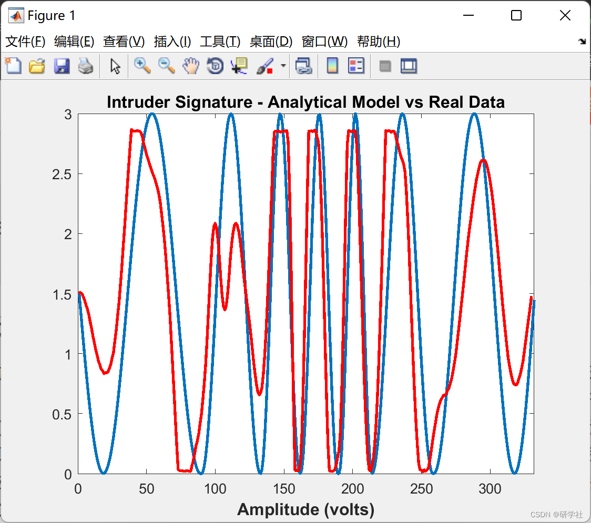
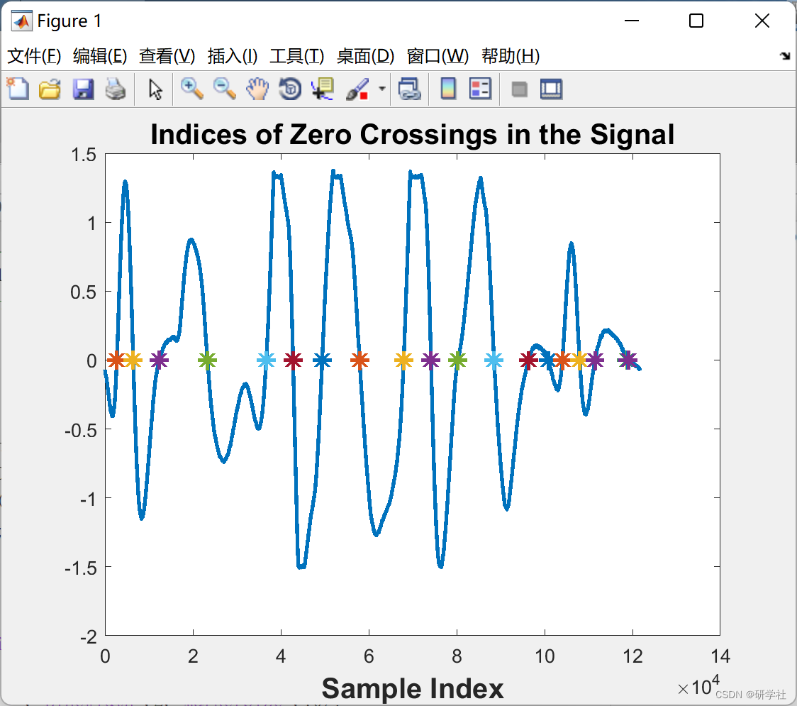

# PIR Sensor Intrusion Detection Algorithm and Analysis Research (Matlab Code Implementation)

🏆 Bloggers' Advantages: 🌞🌞🌞 The content of the blog is assiduously thought-out and logically clear to facilitate readers.
⛳️ Mantra: A journey of a thousand miles begins with a single step. Directory💥1 Overview📚2 Run Results🎉3 References🌈4 MATLAB Code Implementation  
💥1 Overview of the low complexity algorithm for intrusion detection based on PIR in wireless sensor networks, researching the problem of detecting human intruders in wind-induced clutter caused by vegetation in an unpowered infrared (PIR) wireless sensor network (WSN). Proposed a low complexity algorithm based on Haar transform (HT) and Support Vector Machine (SVM) training combination. This algorithm has been extensively tested on-site. It shows excellent performance. The goal is to propose models for intruder signatures. Providing closed-form expressions to well approximate intruder waveforms. First developed PIR sensor feature model in literature. Used to determine how to optimally place multiple sensor nodes to estimate the path of the intruder moving.  
📚2 Run Results​Edit  
​Edit  
Part of the code:  
clear all; close all; clc  
% Load Real Data  
load C2v0800016.dat; A=C2v0800016(:,2);  
% Signal region of interest  
A=A(42300:164100);  
% remove DC in signal  
A=A-mean(A);  
k=1;  
for i=1:length(A)-1  
if((A(i)<0 && A(i+1)>=0)||(A(i)>0 && A(i+1)<=0))  
index(k)=i;  
k=k+1;  
end;  
end;  
plot(A,'LineWidth',2);  
hold on;
plot(index,0,'*','LineWidth',2,'MarkerSize',10);  
title('Indices of Zero Crossings in the Signal','FontSize',15,'FontWeight','bold')  
xlabel('Sample Index','FontSize',15,'FontWeight','bold')  
🎉3 References
[2]Abu Sajana R*., R. Subramanian*, P. Vijay Kumar, Syam Krishnan, Bharadwaj Amrutur, Jeena Sebastian, Malati Hegde, S. V. R. Anand, "A Low-Complexity Algorithm for Intrusion Detection in a PIR-Based Wireless Sensor Network," In 5th International Conference on Intelligent Sensors, Sensor Networks and Information Processing (ISSNIP), pages 337–342, Dec 2009.  
[3] The SmartDetect WSN Team, "SmartDetect: An efficient WSN implementation for intrusion detection," Communication Systems and Networks (COMSNETS), 2010 Second International Conference on, Bangalore, 2010, pp. 1-2.  
🌈4 Matlab code implementation

## Images

<!-- PAYMENT_BLOCK -->

## Get this dataset

- Payment link (Stripe): [Buy now](https://buy.stripe.com/3cs8yP7sY87d0vu9AB)
- Payment QR code: 

<!-- /PAYMENT_BLOCK -->
